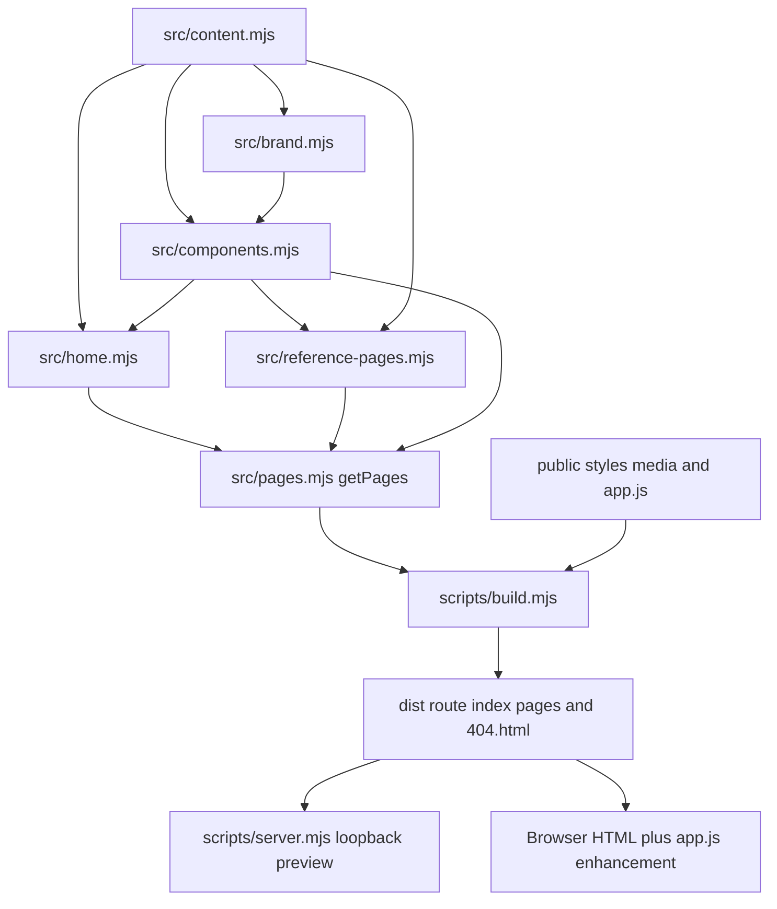

# Holifit: detailed project guide

Analysis date: 2026-10-29. This guide describes the current source snapshot and the behavior visible in code. Application/browser checks were not rerun during this analysis.

## Purpose and boundaries

HoliFit is a dependency-free local reconstruction of a corporate wellness marketing website. It pre-renders a catalogue of service, company, resource, calculator, blog and legal-placeholder pages. Browser JavaScript enhances menus, carousels, video controls, forms and an adult energy calculator. It has no account system, database, actual booking engine, connected catalog delivery or enabled inquiry backend by default.

The README reports 29 pre-rendered routes. The authoritative catalogue is `getPages()` in `src/pages.mjs`; the static checker verifies unique routes and internal links when run. Service records drive repeated routes, so additions to content can change the count without editing the build script.

## Reading order

1. `README.md` and `UX-CONTRACT.md`: scope, integrations and shared behavior.
2. `src/content.mjs`: public business settings, services and media slots.
3. `src/brand.mjs` and `src/components.mjs`: shared rendering primitives/document shell.
4. `src/home.mjs` and `src/reference-pages.mjs`: actual page layouts.
5. `src/pages.mjs`: final route assembly and reference-layout overrides.
6. `public/app.js`: client-only behavior and validation.
7. `scripts/build.mjs`, `scripts/server.mjs`, `scripts/check.mjs`: packaging, preview and static checks.

## Architecture



Rendering is performed at build time with ES-module functions returning HTML strings. There is no React/Vue component runtime and no client router. Every route receives a full document shell with shared header/footer and the same CSS/browser script. Links continue to work through static directory-index pages. Interactive disclosures/calculator/forms depend on browser JavaScript.

The route assembly has two stages: `getPages()` first constructs fallback page bodies, then calls `referenceBody(page)` to apply richer route-specific layouts before calling `shell`. Reading only the initial body literals in `pages.mjs` will miss the final page appearance.

## Content and route model

`site` owns public business metadata, default media, `bookingUrl`, and `formEndpoint`. The two integration settings are intentionally empty in the analyzed source. Other exports include `pageMedia`, `services`, `navigation`, `clientLogos`, `mediaLogos`, `faqs`, `testimonials`, and `resources`. These are build-time records, not records fetched from a live CMS.

`services` records have unique slugs that create service routes and menu entries. `getPages()` adds company/about, testimonials, resources/tools, blog, contact, scheduling, 404, legal, sitemap, and editorial/resource placeholders. The build writes `<route>/index.html` and separately emits `404.html` from the 404 page. The intended static host must use `404.html` as its error document rather than turning every missing route into the homepage.

## Template responsibilities

| Module | Main role |
| --- | --- |
| `src/brand.mjs` | Logo/image placeholder, active navigation, services menu, resource disclosure, shared footer and contact/map band. |
| `src/components.mjs` | Escaping, styled links, image/placeholder figures, FAQ/testimonials, call-to-action, inquiry form and full HTML shell. |
| `src/home.mjs` | Reference-led homepage with wellness programs, client placeholders, FAQs, testimonials and catalog form. |
| `src/reference-pages.mjs` | Distinct service/company/editorial layouts, catalog sections and calculator form; falls back to the supplied page body. |
| `src/pages.mjs` | Page catalogue, route data and final composition into complete HTML. |

`escape` protects values inserted into common HTML slots. Some templates deliberately contain authored HTML literals, so the existence of the helper does not establish that arbitrary untrusted CMS content would be safe. A future CMS adapter needs an explicit input/escaping contract rather than treating current authored strings as a general sanitization system.

## Browser state and data flows

Menus are represented by DOM attributes/classes and native `details` state rather than a global state store. `closeServices` hides the services menu and updates `aria-expanded`; `closeNav` also resets mobile navigation. Selection, outside click, Escape, focus exit and a desktop media-query transition close relevant disclosures. The shared shell is expected to render the menu controls on every page because `public/app.js` accesses them directly.

The logo carousel scrolls its track when arrow controls are clicked. Reduced motion switches it to immediate movement. Background video, when configured, has pause/play synchronization and is initially paused when reduced motion is preferred.

Catalog forms validate required values and email validity, then explain that delivery is disconnected. The code does not submit those entries. Booking uses an approved `bookingUrl` only when one is configured; otherwise the scheduling page explains the unconnected state and presents contact choices.

### Inquiry flow

1. The build writes `site.formEndpoint` and `site.email` to form data attributes.
2. The browser validates required inputs, marks invalid fields and focuses the first failure.
3. With the default empty endpoint, it prepares a `mailto:` link with the entered inquiry. The visitor must choose the link and send through their mail application. The website has not sent the inquiry.
4. If an endpoint is intentionally configured later, the browser POSTs JSON, waits at most 15 seconds, disables the submit button during the request, treats non-2xx as failure and preserves values on failure. Confirmed success resets the form.

The future endpoint contract includes first/last name, email, phone, company, service and message strings. No endpoint was enabled or called by this analysis. The static checker intentionally asserts that `site.formEndpoint` is empty; changing it requires a deliberate test/contract update as described in README.

### Energy calculator flow

The calculator runs entirely in `public/app.js`; no input is stored or sent. It supports metric/imperial units and a known-BMR mode. Unit changes convert displayed weight/height and clear results. Known-BMR mode disables the demographic/body measurements and accepts a BMR in the coded 500–5,000 range.

In calculated mode, the code checks age, normalized weight/height and optional body-fat limits. With body fat, BMR is `370 + 21.6 * weight * (1 - fat/100)`. Otherwise it uses `10 * weight + 6.25 * height - 5 * age` plus the sex-dependent constant. It rounds BMR multiplied by the selected activity factor to produce TDEE. Results are written with DOM text nodes to the status region and receive focus. This describes the implementation; it does not validate the calculator as medical/nutritional advice or establish that every invalid numeric edge case has been tested.

## Build and local preview

`scripts/build.mjs` uses only Node filesystem APIs and `getPages()`: it creates `dist`, copies `public`, and writes complete route documents. There is no dependency install, bundler or remote content fetch in the normal build.

`scripts/server.mjs` imports the build at startup, then serves the generated files on loopback, normally port 4173. It resolves directory paths to `index.html`, rejects paths outside the dist boundary and serves a real 404 status with `404.html` when a file is missing. It validates `PORT`, recognizes an existing matching Holifit preview by document markers, and tries subsequent ports for unrelated collisions. It does not terminate the process using a busy port. This server is for local preview; static hosting behavior is a separate operational choice.

`public/styles.css` provides base tokens/forms/accessibility rules; `public/reference.css`, loaded afterward, owns the current reference-led layouts. Local Poppins/Oswald font files and their licenses are bundled; binary media bytes were excluded from graph analysis.

## Commands and verification boundaries

These source-documented commands are available; they were **not run as app checks during this analysis**:

```powershell
npm run check
npm run build
npm run dev
# With the local preview available at the expected URL:
node scripts/browser-check.cjs
node scripts/visual-review.cjs
node scripts/server-check.mjs
```

`npm run check` includes Node syntax checks and `scripts/check.mjs`. The latter checks route/slug uniqueness, one h1, a main landmark, internal destinations, local media existence and disconnected endpoint defaults. Browser scripts use existing Playwright packages (including a sibling workspace fallback), visit the local site and write artifacts. `scripts/reference-check.cjs` and `scripts/reference-pages.cjs` visit the public reference; they were not executed and are not prerequisites for ordinary local use.

`REVIEW.md` contains historical evidence and open content/release issues. Current analysis checks cover graph shape, references, eligible-file representation and fingerprint generation only. It did not independently verify browser interaction, external endpoint delivery, production hosting, performance under load, full accessibility, original-media licensing or legal copy.

## Change guide and pitfalls

| Change | Owner | Consequences to check |
| --- | --- | --- |
| Service/copy changes | `src/content.mjs` | Generated routes, navigation, service layouts, unique slugs and internal links. |
| New page layout | `src/reference-pages.mjs` / `src/pages.mjs` | Final override body, one h1/main landmark, shell and route uniqueness. |
| Form behavior | `src/components.mjs` + `public/app.js` | Data attributes, field IDs/error IDs, validation and honest delivery state. |
| Booking/backend connection | Explicit approved configuration | Contract/security/privacy review, server validation, duplicate prevention and updated disconnected-default assertion. |
| Replace media | `public/media/` + content exports | URL paths, reserved dimensions, alt text and publication rights. |
| Styles | Base then reference CSS | Cascade order, responsive layout and shared controls across all routes. |

The code is compact and many rendering functions occupy very long source lines. Line counts alone understate complexity. Some page and helper functions are exported despite being one-line implementations; the graph includes exported symbols while the source catalogue retains other named helpers. Anonymous event handlers are explained in the browser-flow sections rather than modelled as a perfect call graph.

## Analysis artifacts and rollback

`.ua/knowledge-graph.json` contains six layers and a seven-step tour. `.ua/coverage-report.json` records eligible-file coverage and limitations. `.ua/fingerprints.json` is the baseline for later updates; automatic updates are disabled and no hooks were installed.

Generated `artifacts/` capture data, dist, dependencies, binary media, secrets and local/private data are excluded. Every eligible scanned source/config/document file has a graph node. Third-party internals and actual live-site behavior are outside this source snapshot.

Rollback for this documentation task: remove only the new guide and generated `.ua` analysis artifacts after reviewing changes; no application source was modified. Retain `.ua/.understandignore` if its approved exclusions should be reused.


## Complete eligible-file catalogue

Each row corresponds to an actual scanned file and a file-level graph node. Links are relative to this project.

| File | Role |
| --- | --- |
| [DESIGN.md](DESIGN.md) (52 lines) | Records brand direction, typography, colors, layout and accessibility decisions that guide the rendered site. |
| [MEDIA-GUIDE.md](MEDIA-GUIDE.md) (29 lines) | Explains replaceable local image/video slots, file locations, recommended dimensions and rebuild steps. |
| [README.md](README.md) (111 lines) | Explains local startup, editable source boundaries, integration limitations, verification commands and recovery. |
| [REVIEW.md](REVIEW.md) (39 lines) | Records historical local validation and unresolved content, legal/media and release limitations. |
| [Start Holifit.cmd](Start%20Holifit.cmd) (7 lines) | Starts the Node-based Holifit preview from the project directory. |
| [TASKS.md](TASKS.md) (32 lines) | Records task history, completed changes and remaining limitations; these historical checks are not rerun by this analysis. |
| [UX-CONTRACT.md](UX-CONTRACT.md) (18 lines) | Defines canonical owners and consistent navigation, form, feedback, media and accessibility behavior. |
| [package.json](package.json) (12 lines) | Defines Node runtime requirements and the documented startup/build/check commands; no application execution is performed here. |
| [public/app.js](public/app.js) (57 lines) | Adds browser-only navigation, disclosure dismissal, carousel/video controls, local energy calculations and validation with disconnected-default inquiries. |
| [public/fonts/Oswald-OFL.txt](public/fonts/Oswald-OFL.txt) (93 lines) | Contains the bundled Oswald font license and redistribution terms. |
| [public/fonts/Poppins-OFL.txt](public/fonts/Poppins-OFL.txt) (93 lines) | Contains the bundled Poppins font license and redistribution terms. |
| [public/media/README.md](public/media/README.md) (8 lines) | Documents where licensed replacement media belongs and how browser URLs map to the public directory. |
| [public/reference.css](public/reference.css) (92 lines) | Applies reference-led typography and responsive homepage/secondary-page layouts above the base stylesheet. |
| [public/styles.css](public/styles.css) (12 lines) | Supplies shared base design tokens, layouts, form controls, visible scrollbars and accessibility foundations. |
| [scripts/browser-check.cjs](scripts/browser-check.cjs) (68 lines) | Uses installed Playwright for local route navigation, disclosure controls, calculator/form behavior and responsive screenshots. |
| [scripts/build.mjs](scripts/build.mjs) (14 lines) | Copies public assets and writes a directory index HTML file for each route plus a separate 404.html into dist. |
| [scripts/check.mjs](scripts/check.mjs) (19 lines) | Asserts unique routes/slugs, one h1 and main landmark, valid internal links/media and the disconnected form endpoint default. |
| [scripts/reference-check.cjs](scripts/reference-check.cjs) (23 lines) | Inspects the public Holifit homepage with Playwright and saves reference observations; intentionally not executed here. |
| [scripts/reference-pages.cjs](scripts/reference-pages.cjs) (3 lines) | Captures public Holifit secondary-page screenshots and headings into artifacts; intentionally not executed here. |
| [scripts/server-check.mjs](scripts/server-check.mjs) (16 lines) | Creates synthetic loopback servers to verify a busy unrelated port is preserved and preview moves to the next port. |
| [scripts/server.mjs](scripts/server.mjs) (40 lines) | Builds before serving dist on loopback port 4173 by default, contains traversal boundaries, serves true 404 responses and handles port collisions. |
| [scripts/visual-review.cjs](scripts/visual-review.cjs) (4 lines) | Visits generated local routes across viewport widths and records screenshots, overflow findings and runtime errors. |
| [src/brand.mjs](src/brand.mjs) (6 lines) | Renders the shared logo, navigation, footer and contact/map band used throughout generated routes. |
| [src/components.mjs](src/components.mjs) (13 lines) | Provides escaped HTML primitives, media/FAQ/testimonial sections, the contact form contract and the complete document shell. |
| [src/content.mjs](src/content.mjs) (53 lines) | Exports shared site settings, service records, navigation, media slots, FAQs, testimonials and resource placeholders for build-time rendering. |
| [src/home.mjs](src/home.mjs) (22 lines) | Renders the reference-led wellness homepage with service features, client placeholders, testimonials, FAQs and disconnected catalog form. |
| [src/pages.mjs](src/pages.mjs) (21 lines) | Builds the full page catalogue from service/content exports, selects reference layouts and wraps each route in the shared HTML shell. |
| [src/reference-pages.mjs](src/reference-pages.mjs) (31 lines) | Selects distinct secondary-page layouts and renders the adult BMR/TDEE calculator form and catalog sections. |

## Named symbol catalogue

This catalogue preserves all named functions and class records returned by the bundled structural extractor, including small helpers that do not meet the graph significance threshold. Line ranges refer to this analyzed source snapshot and may shift after edits. Anonymous callbacks and exported data constants are not function declarations.

| Source | Symbol | Lines | Exported | Role when represented in graph |
| --- | --- | --- | --- | --- |
| [src/brand.mjs](src/brand.mjs) | `e` | 2–2 | No | Small local helper; inspect its source context for the complete expression. |
| [src/brand.mjs](src/brand.mjs) | `logo` | 3–3 | Yes | Renders the configured logo image or the honest SVG wordmark placeholder. |
| [src/brand.mjs](src/brand.mjs) | `header` | 4–4 | Yes | Renders shared navigation with active-route state, services menu, resource disclosure and consultation link. |
| [src/brand.mjs](src/brand.mjs) | `footer` | 5–5 | Yes | Renders shared footer navigation and legal destinations. |
| [src/brand.mjs](src/brand.mjs) | `contactBand` | 6–6 | Yes | Renders shared contact destinations and the schematic replaceable location map. |
| [src/components.mjs](src/components.mjs) | `escape` | 4–4 | Yes | Escapes HTML-sensitive characters before inserting values into generated markup. |
| [src/components.mjs](src/components.mjs) | `button` | 5–5 | Yes | Renders an escaped anchor in primary or outline button styling. |
| [src/components.mjs](src/components.mjs) | `media` | 6–8 | Yes | Renders a reserved-size local image or an explicitly labelled placeholder figure. |
| [src/components.mjs](src/components.mjs) | `faq` | 9–9 | Yes | Renders content-driven FAQ disclosures. |
| [src/components.mjs](src/components.mjs) | `quotes` | 10–10 | Yes | Renders editable testimonial placeholders without asserting approved real endorsements. |
| [src/components.mjs](src/components.mjs) | `cta` | 11–11 | Yes | Renders the shared consultation call-to-action. |
| [src/components.mjs](src/components.mjs) | `form` | 12–12 | Yes | Builds named inquiry inputs, inline error/status slots and disconnected-default endpoint/email attributes. |
| [src/components.mjs](src/components.mjs) | `shell` | 13–13 | Yes | Wraps a page body with metadata, styles, browser script, shared header, main landmark and footer. |
| [src/home.mjs](src/home.mjs) | `tile` | 6–6 | No | Small local helper; inspect its source context for the complete expression. |
| [src/home.mjs](src/home.mjs) | `partner` | 7–7 | No | Small local helper; inspect its source context for the complete expression. |
| [src/home.mjs](src/home.mjs) | `home` | 8–22 | Yes | Renders the reference-led homepage using the current service/content catalogue. |
| [src/reference-pages.mjs](src/reference-pages.mjs) | `hero` | 3–3 | No | Small local helper; inspect its source context for the complete expression. |
| [src/reference-pages.mjs](src/reference-pages.mjs) | `catalog` | 4–4 | No | Small local helper; inspect its source context for the complete expression. |
| [src/reference-pages.mjs](src/reference-pages.mjs) | `video` | 5–5 | No | Small local helper; inspect its source context for the complete expression. |
| [src/reference-pages.mjs](src/reference-pages.mjs) | `clients` | 6–6 | No | Small local helper; inspect its source context for the complete expression. |
| [src/reference-pages.mjs](src/reference-pages.mjs) | `referenceBody` | 20–30 | Yes | Chooses a specific reference layout by route slug and falls back to the page body when no override exists. |
| [src/reference-pages.mjs](src/reference-pages.mjs) | `calculatorPage` | 31–31 | No | Small local helper; inspect its source context for the complete expression. |
| [src/pages.mjs](src/pages.mjs) | `intro` | 4–4 | No | Small local helper; inspect its source context for the complete expression. |
| [src/pages.mjs](src/pages.mjs) | `serviceCard` | 5–5 | No | Small local helper; inspect its source context for the complete expression. |
| [src/pages.mjs](src/pages.mjs) | `getPages` | 7–21 | Yes | Creates route descriptors, adds service and editorial/resource/legal pages, applies referenceBody and returns complete HTML for each. |
| [public/app.js](public/app.js) | `closeServices` | 32–32 | No | Small local helper; inspect its source context for the complete expression. |
| [public/app.js](public/app.js) | `closeNav` | 33–33 | No | Small local helper; inspect its source context for the complete expression. |

## Coverage result

- Eligible files represented: **28/28**.
- Graph nodes: **43** (18 file, 15 function, 9 document, 1 config).
- Graph edges: **69**; layers: **6**; guided steps: **7**.
- Core KnowledgeGraphSchema validation, unique IDs, existing edge/layer/tour references and exactly-one-layer file assignment passed.
- Bundled fingerprint baseline succeeded for all **28** eligible files before metadata was saved.
- The merge helper removed 5 path-convention test associations that did not satisfy its canonical test-file recognition. The guide therefore describes the actual check scripts explicitly; missing tested_by edges do not mean those scripts do not exist.
- Unsupported non-code formats receive file-level descriptions and conservative content fingerprints; no unsupported parser is represented as an execution trace.
